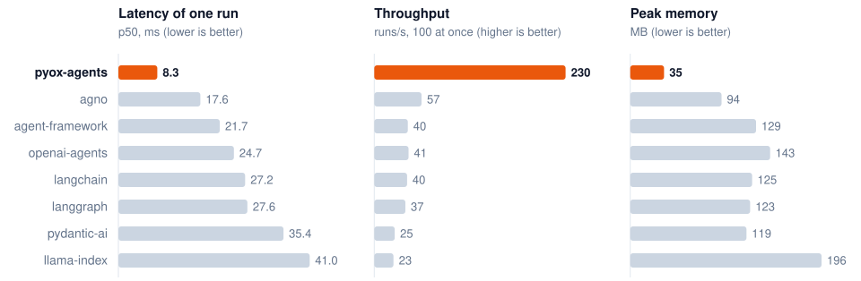

<p align="center">
  <a href="https://daniprol.github.io/pyox-agents/">
    <picture>
      <source media="(prefers-color-scheme: dark)" srcset="https://raw.githubusercontent.com/daniprol/pyox-agents/main/docs/assets/logo-wordmark-dark.svg">
      
    </picture>
  </a>
</p>

<p align="center">
  <strong>The fastest, lightest way to build AI agents in Python.</strong><br>
  A small Python API on top of a Rust core that runs the whole agent loop.
</p>

<p align="center">
  <a href="https://github.com/daniprol/pyox-agents/actions/workflows/ci.yml"></a>
  <a href="https://pypi.org/project/pyox-agents/"></a>
  <a href="https://pypi.org/project/pyox-agents/"></a>
  <a href="https://daniprol.github.io/pyox-agents/"></a>
  <a href="https://github.com/daniprol/pyox-agents/blob/main/LICENSE"></a>
</p>

<p align="center">
  <a href="https://daniprol.github.io/pyox-agents/">Documentation</a> ·
  <a href="#quickstart">Quickstart</a> ·
  <a href="https://daniprol.github.io/pyox-agents/benchmarks/">Benchmarks</a> ·
  <a href="https://github.com/daniprol/pyox-agents/tree/main/examples">Examples</a>
</p>

---

You write agents in plain Python: a model, instructions and tools. Rust does the rest: HTTP, streaming, JSON
parsing, tool dispatch and the loop that ties them together. The result is an agent library with no Python
dependencies that imports and builds an agent in 0.13 s (others: 1.5 to 3.2 s), and spends its time waiting on
the model, not on itself.

Against seven popular agent frameworks, on the same tasks and the same fake model server:

<p align="center">
  <picture>
    <source media="(prefers-color-scheme: dark)" srcset="https://raw.githubusercontent.com/daniprol/pyox-agents/main/docs/assets/benchmark-dark.svg">
    
  </picture>
</p>

<sub>One agent run with one tool call, 500 runs per library, 100 at once for throughput. The model answers
instantly, so this is each library's own overhead. Compared: pydantic-ai, OpenAI Agents SDK, Microsoft Agent
Framework, LangGraph, LangChain, LlamaIndex and Agno. [Method, every number and how to reproduce
them](https://github.com/daniprol/pyox-agents/tree/main/benchmarks).</sub>

## Quickstart

```bash
uv add pyox-agents          # or: pip install pyox-agents
export OPENAI_API_KEY=sk-...
```

```python
import asyncio

from pyox_agents import Agent, TextDelta, tool


@tool
def get_weather(city: str) -> str:
    """Get the current weather in a city."""
    return f"Sunny in {city}"


agent = Agent(model="gpt-5-mini", instructions="Be concise.", tools=[get_weather])


async def main() -> None:
    async for event in agent.execute("Weather in Vigo?"):
        if isinstance(event, TextDelta):
            print(event.text, end="", flush=True)


asyncio.run(main())
```

The schema of `get_weather` comes from its type hints and docstring. Events (`TextDelta`, `ToolStarted`,
`ToolFinished`, `RunFinished`) are typed objects built in Rust. Don't need streaming? `result = await
agent.run("...")` returns the final event, with `result.text`, `result.usage` and `result.messages`.

Prebuilt wheels cover Linux, macOS and Windows on Python 3.11 and newer.

## Drop to Rust when Python is the bottleneck

Tools, hooks and history stores can also be written in Rust, in your own package. The model calls them
without going through Python at all; the argument schema is generated from the struct:

```rust
/// Count the words in a text.
#[derive(Deserialize, JsonSchema)]
struct CountWords {
    /// The text to count words in.
    text: String,
}

impl RustTool for CountWords {
    const NAME: &'static str = "count_words";

    fn run(self) -> Result<String, String> {
        Ok(self.text.split_whitespace().count().to_string())
    }
}
```

```python
import fast_tools  # your Rust package, built with maturin

agent = Agent(model="gpt-5-mini", tools=[fast_tools.count_words])
```

Start from [`examples/rust_tool_package`](https://github.com/daniprol/pyox-agents/tree/main/examples/rust_tool_package),
or read [Tools](https://daniprol.github.io/pyox-agents/tools/#your-own-rust-tools).

## What's included

Small surface, the features production agents need:

| Feature | What you get |
|---|---|
| [Streaming](https://daniprol.github.io/pyox-agents/streaming/) | Typed events, `run.stop()`, token usage, and text grouped by delta, paragraph or message. |
| [Tools](https://daniprol.github.io/pyox-agents/tools/) | Sync or async Python functions, dataclass and pydantic arguments, run context with your dependencies, or Rust. |
| [Structured output](https://daniprol.github.io/pyox-agents/structured-output/) | `Agent(output_type=...)` with a dataclass, `TypedDict`, pydantic model or JSON schema. |
| [History](https://daniprol.github.io/pyox-agents/history/) | Plain dicts in and out, JSON parsed in Rust, and pluggable stores in Python or Rust. |
| [Human in the loop](https://daniprol.github.io/pyox-agents/human-in-the-loop/) | Approvals, questions from inside a tool, and frontend tools. Resumable, with no database. |
| [Subagents](https://daniprol.github.io/pyox-agents/subagents/) and [state](https://daniprol.github.io/pyox-agents/state/) | Agents as tools, in the same event stream, with a shared JSON state. |
| [Hooks](https://daniprol.github.io/pyox-agents/hooks/) | Watch or change a run before and after each model request and tool call. |
| [Web frontends](https://daniprol.github.io/pyox-agents/web-frontends/) | Serve the Vercel AI SDK (`useChat`) and AG-UI (CopilotKit) protocols, written by Rust. |
| [Tracing](https://daniprol.github.io/pyox-agents/telemetry/) | OpenTelemetry spans and metrics following the GenAI conventions. Free when off. |
| [Images and files](https://daniprol.github.io/pyox-agents/images-and-files/) | Images and PDFs in prompts and in tool results. |
| [APIs](https://daniprol.github.io/pyox-agents/client/) | OpenAI Chat Completions and any compatible server (Ollama, for example), the [Responses API](https://daniprol.github.io/pyox-agents/responses-api/) (also over WebSocket), the [Decisions API](https://daniprol.github.io/pyox-agents/decisions/) and Azure OpenAI. |

## How it works

```text
Python                                Rust
Agent(model, instructions, tools) ──► Engine      config shared by all runs
agent.execute(prompt)             ──► Run         history + bounded event queue
async for event in run            ◄── agent loop  request → stream → tools → repeat
                                        ├── one adapter file per API (Chat Completions, Responses)
                                        ├── Python tools awaited on your event loop
                                        └── Rust tools called directly, no Python involved
```

One `Agent` serves any number of concurrent runs. The Rust code is written to be read by Python developers:
small files, plain names and comments on every Rust-specific idea. Start at
[`src/lib.rs`](https://github.com/daniprol/pyox-agents/blob/main/src/lib.rs).

## For coding agents

[`skills/pyox-agents`](https://github.com/daniprol/pyox-agents/tree/main/skills/pyox-agents) is an
[Agent Skill](https://agentskills.io) that teaches Claude Code, Codex and other agents that read `SKILL.md` how to build
with pyox-agents, including Rust tools, hooks and history stores:

```bash
npx skills add daniprol/pyox-agents
```

Agents working on this repository read [`AGENTS.md`](https://github.com/daniprol/pyox-agents/blob/main/AGENTS.md).

## Status

pyox-agents is young (0.x) and its API may still change before 1.0. Anthropic and Gemini adapters are next.
Issues and pull requests are welcome: see [CONTRIBUTING.md](https://github.com/daniprol/pyox-agents/blob/main/CONTRIBUTING.md).

Inspired by [pi](https://github.com/earendil-works/pi). [MIT license](https://github.com/daniprol/pyox-agents/blob/main/LICENSE).
